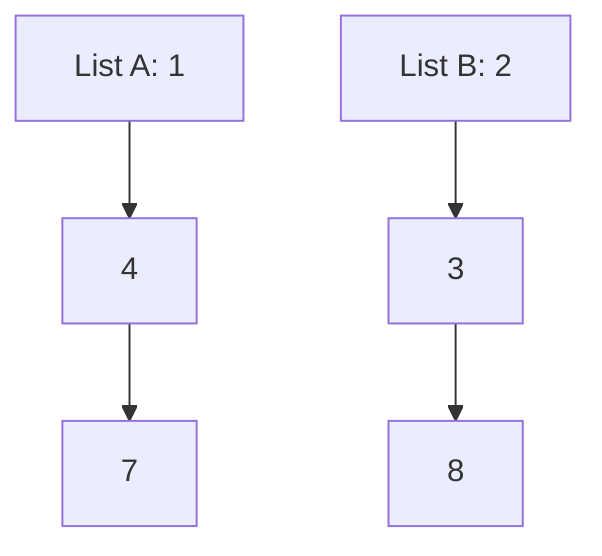
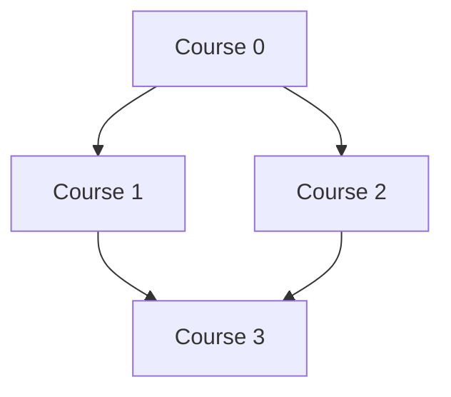

# Part 7: Fully Worked LeetCode Problems

This part applies the process from Part 6 to **14 real problems: four Easy, six Medium, and four Hard**.

For each problem, we will establish what the answer means, build a direct solution, identify what can improve, trace the resulting algorithm, and examine its correctness and complexity.

The Python implementations passed **45,453 differential and property checks**, plus edge examples and **1,920 additional comparisons for Word Search**.

You can download the executable code companion:

[part7_solutions.py](/code/part7_solutions.py)

The code blocks below use LeetCode’s `class Solution` format. Each block is a separate submission. In the companion, the classes have different names so they can coexist in one file.

Throughout this part:

- \(n\) usually means the number of input elements.
- **Auxiliary space** means additional working memory, excluding the input.
- Hash-map and set complexity assumes their usual average constant-time operations.
- Arithmetic complexity uses the usual model in which the problem’s integer operations take constant time.

Read the problem and hand examples first. Attempt the guided questions before opening their answers.

---

## 7.1 — Two Sum

**LeetCode 1 · Easy · Hash maps**

### Problem statement and constraints

Given an integer list `nums` and an integer `target`, return the **indices of two different elements** whose values add to `target`.

Exactly one valid pair exists. Either order of indices is acceptable.

Constraints:

- \(2 \le n \le 10^4\).
- Values and target are between \(-10^9\) and \(10^9\).
- You cannot use the same position twice. [LeetCode](https://leetcode.com/problems/two-sum/description/?utm_source=chatgpt.com)

### Examples traced by hand

Consider:

```python
nums = [4, 1, 6, 9]
target = 7
```

The values `1` and `6` add to `7`.

Their indices are `1` and `2`, so the answer is:

```python
[1, 2]
```

The answer is not `[1, 6]`. Those are values, but the problem requests positions.

Another example:

```python
nums = [3, 3]
target = 6
```

The answer is:

```python
[0, 1]
```

Equal values are allowed. Reusing one position is not.

### My naive/brute-force thinking and why it is too slow

A direct thought is:

> “Try every pair of different positions.”

```python
def two_sum_brute(nums, target):
    # Choose the first position.
    for first in range(len(nums)):

        # Choose a later position, so we never reuse one position.
        for second in range(first + 1, len(nums)):

            # Check whether this pair solves the problem.
            if nums[first] + nums[second] == target:
                return [first, second]

    # The official problem guarantees a solution.
    return []
```

The number of pairs is:

\[
\frac{n(n-1)}{2}.
\]

Time is \(O(n^2)\). Auxiliary space is \(O(1)\).

For \(10{,}000\) elements, this can require about 50 million pair checks.

### The key insight and how to discover it

Fix the current value.

If:

\[
current+partner=target,
\]

then:

\[
partner=target-current.
\]

Instead of comparing the current value with every earlier value, ask:

> “Have I already seen the exact partner I need?”

A dictionary can answer that question and preserve the partner’s index.

The dictionary means:

```text
previously seen value -> its index
```

We check before inserting the current value. This guarantees that a match comes from an earlier position.

### Step-by-step walkthrough

For `[4, 1, 6, 9]`, target `7`:

| Index | Value | Needed partner | Dictionary before checking | Action |
|---:|---:|---:|---|---|
| 0 | 4 | 3 | `{}` | Store `4: 0` |
| 1 | 1 | 6 | `{4: 0}` | Store `1: 1` |
| 2 | 6 | 1 | `{4: 0, 1: 1}` | Return `[1, 2]` |

We never need to process `9`.

**Why this is correct:** when the later member of the valid pair is processed, the earlier member is already in the dictionary. The lookup finds it.

### Final clean code with comments

```python
class Solution:
    def twoSum(self, nums, target):
        # Map each earlier value to an index where it appeared.
        seen = {}

        # Read each value together with its original position.
        for index, value in enumerate(nums):
            # Calculate the value needed to complete the pair.
            needed = target - value

            # A match here belongs to an earlier position.
            if needed in seen:
                return [seen[needed], index]

            # Make this value available to future positions.
            seen[value] = index

        # This is outside the official guarantee of one solution.
        return []
```

### Time and space complexity with justification

- **Expected time: \(O(n)\).** Each element causes a constant number of dictionary operations.
- **Auxiliary space: \(O(n)\).** The dictionary can contain a linear number of values.

### Common mistakes and edge cases

> **Common misconception**
>
> “A duplicate value means the same element was used twice.”
>
> Two positions can contain equal values. The restriction concerns positions.

Other mistakes:

- Returning values instead of indices.
- Inserting before checking and accidentally pairing an element with itself.
- Sorting without preserving original indices.
- Assuming values must be positive.

### Related problems to practice

- Top K Frequent Elements, later in this part, develops frequency dictionaries.
- The longest target-sum subarray from Part 6 develops dictionaries that store positions.

### Practice

1. Trace `[8, 2, 5]` with target `7`.
2. Why does `[3, 3]` work with the dictionary algorithm?
3. What goes wrong if the current value is inserted before checking on `[3, 4]`, target `6`?

<details>
<summary>Answers and explanations</summary>

1. Store `8`, then `2`. At value `5`, the needed value is `2`, so return `[1, 2]`.
2. The first `3` is stored at index `0`. The second `3` finds that earlier occurrence.
3. At index `0`, inserting `3` first makes the algorithm find that same position as its own partner. That input is outside the official one-solution guarantee, but it clearly exposes the faulty operation order.

</details>

---

## 7.2 — Valid Parentheses

**LeetCode 20 · Easy · Stacks**

### Problem statement and constraints

Given a string containing only these six bracket characters:

```text
( ) [ ] { }
```

determine whether every closing bracket matches an opening bracket of the same type in the correct nesting order.

The string length is between `1` and \(10^4\). [LeetCode](https://leetcode.com/problems/valid-parentheses/description/?utm_source=chatgpt.com)

### Examples traced by hand

Valid:

```text
{[]}
```

The square brackets close before the surrounding braces.

Invalid:

```text
([)]
```

The `)` tries to close `(` while `[` is still unresolved inside it.

Invalid:

```text
((
```

There are opening brackets left without matching closers.

### My naive/brute-force thinking and why it is too slow

One tempting approach is to count each bracket type.

But:

```text
([)]
```

has matching counts and is still invalid.

A correct slower approach repeatedly removes adjacent matching pairs:

```text
{[]} -> {} -> empty
```

A valid nonempty bracket string always contains an innermost matching pair. Repeated removal eventually empties a valid string.

However, deeply nested input can require many full scans and string reconstructions. The worst-case time is \(O(n^2)\).

### The key insight and how to discover it

When a closing bracket arrives, which opener must it match?

The **most recent opener that has not yet been closed**.

That is last-in, first-out behavior, which a stack supports.

The stack holds unresolved opening brackets.

### Step-by-step walkthrough

For:

```text
{[]}
```

The right side of the displayed list is the stack’s top.

| Character | Stack before | Required action | Stack after |
|---|---|---|---|
| `{` | `[]` | Push opener | `['{']` |
| `[` | `['{']` | Push opener | `['{', '[']` |
| `]` | `['{', '[']` | Match and remove `[` | `['{']` |
| `}` | `['{']` | Match and remove `{` | `[]` |

The stack is empty at the end, so the answer is `True`.

**Invariant:** after processing a prefix of the string, the stack contains exactly its unmatched opening brackets in their nesting order.

### Final clean code with comments

```python
class Solution:
    def isValid(self, s):
        # For each closing bracket, record the required opener.
        opening_for = {
            ")": "(",
            "]": "[",
            "}": "{",
        }

        # Store openers that still need a matching closer.
        stack = []

        # Examine the brackets from left to right.
        for char in s:
            # Membership means this character is a closer.
            if char in opening_for:
                # Reject a closer with no opener, or the wrong opener.
                if not stack or stack[-1] != opening_for[char]:
                    return False

                # The most recent opener has now been matched.
                stack.pop()
            else:
                # Under the input contract, this is an opener.
                stack.append(char)

        # Any remaining opener makes the string invalid.
        return not stack
```

The expression:

```python
not stack
```

is `True` when the list is empty.

### Time and space complexity with justification

- **Time: \(O(n)\).** Every character is processed once.
- **Auxiliary space: \(O(n)\).** A string of opening brackets can place every character on the stack.

### Common mistakes and edge cases

- Checking counts without checking nesting.
- Calling `pop()` on an empty stack.
- Returning `True` after the loop without checking for leftover openers.
- Forgetting that `")("` is invalid despite equal counts.

### Related problems to practice

- Word Search uses a related idea of unresolved choices, with additional backtracking.
- The monotonic-stack exercises from Part 5 use a stack to preserve unresolved candidates.

### Practice

1. Trace `"([])"`.
2. At what character does `"([)]"` fail?
3. Why is an empty stack during the middle of processing acceptable, but an empty stack when a closer arrives can be a problem?

<details>
<summary>Answers and explanations</summary>

1. Push `(`, push `[`, pop `[` for `]`, then pop `(` for `)`. Return `True`.
2. At `)`. The stack’s top is `[`, which cannot be closed by `)`.
3. An empty stack can mean a valid group has finished. But a new closer requires a currently unmatched opener.

</details>

---

## 7.3 — Best Time to Buy and Sell Stock

**LeetCode 121 · Easy · Running minimum**

### Problem statement and constraints

Each list element gives a stock’s price on one day.

Choose one buying day and a later selling day to maximize profit. Return `0` if no profitable transaction exists.

Constraints:

- \(1 \le n \le 10^5\).
- Prices are between `0` and \(10^4\). [LeetCode](https://leetcode.com/problems/best-time-to-buy-and-sell-stock/description/?utm_source=chatgpt.com)

### Examples traced by hand

```python
prices = [8, 3, 6, 2, 7]
```

Possible transactions include:

- Buy at `3`, sell at `6`: profit `3`.
- Buy at `3`, sell at `7`: profit `4`.
- Buy at `2`, sell at `7`: profit `5`.

Answer:

```python
5
```

For:

```python
[9, 7, 4]
```

every later sale loses money. The answer is `0`.

### My naive/brute-force thinking and why it is too slow

Try every buying day and every later selling day.

That examines \(O(n^2)\) transactions.

A tempting shortcut is:

```text
largest price - smallest price
```

But the smallest price may occur after the largest.

For `[9, 2]`, that shortcut produces `7`, even though the profitable ordering is impossible.

### The key insight and how to discover it

Fix the selling day.

The best buying day must have the **lowest price among earlier days**.

We do not need to retain every earlier price. We only need their minimum.

This is information compression: many candidates can be summarized by one value because all future selling decisions prefer the cheapest earlier purchase.

### Step-by-step walkthrough

For `[8, 3, 6, 2, 7]`:

Initialize:

```text
cheapest = 8
best = 0
```

| Day index | Price | Cheapest earlier price | Profit if selling today | Best profit | Cheapest after update |
|---:|---:|---:|---:|---:|---:|
| 1 | 3 | 8 | -5 | 0 | 3 |
| 2 | 6 | 3 | 3 | 3 | 3 |
| 3 | 2 | 3 | -1 | 3 | 2 |
| 4 | 7 | 2 | 5 | 5 | 2 |

We compute today’s sale before making today’s price available as a future purchase.

### Final clean code with comments

```python
class Solution:
    def maxProfit(self, prices):
        # The input is guaranteed to contain at least one price.
        cheapest = prices[0]

        # Making no transaction gives profit 0.
        best = 0

        # A sale needs an earlier buying day.
        for day in range(1, len(prices)):
            # Read today's possible selling price.
            price = prices[day]

            # Use the cheapest price from an earlier day.
            best = max(best, price - cheapest)

            # Today's price may be useful for a future sale.
            cheapest = min(cheapest, price)

        return best
```

### Time and space complexity with justification

- **Time: \(O(n)\).** Each price is examined once.
- **Auxiliary space: \(O(1)\).** Only a fixed number of variables is stored.

### Common mistakes and edge cases

- Ignoring the buy-before-sell requirement.
- Summing every positive daily change. That solves a different problem allowing multiple transactions.
- Returning a negative profit.
- Mishandling the one-day case. Its answer is `0`.

### Related problems to practice

- Trapping Rain Water later uses running boundary maxima.
- The running-minimum and running-maximum exercises from Parts 1 and 2 reinforce the state used here.

### Practice

1. Find the answer for `[5, 1, 4, 2, 8]`.
2. Why is storing the most recent price insufficient?
3. What invariant describes `cheapest` before each iteration?

<details>
<summary>Answers and explanations</summary>

1. `7`, from buying at `1` and selling later at `8`.
2. An older price may be lower and therefore produce a larger profit.
3. It is the minimum price among all days before the current day.

</details>

---

## 7.4 — Merge Two Sorted Lists

**LeetCode 21 · Easy · Linked lists and two pointers**

### Problem statement and constraints

Given the heads of two linked lists sorted in nondecreasing order, combine their existing nodes into one sorted linked list and return its head.

Nondecreasing means values may stay equal as you move forward.

Each list may be empty and has at most 50 nodes. Node values lie between `-100` and `100`. [LeetCode](https://leetcode.com/problems/merge-two-sorted-lists/description/?utm_source=chatgpt.com)

### Examples traced by hand

Consider these two lists:



The result’s values are:

```python
[1, 2, 3, 4, 7, 8]
```

A **head** is the first node. Each node’s `next` reference identifies the following node, or `None` at the end.

LeetCode supplies a node class equivalent to:

```python
class ListNode:
    def __init__(self, val=0, next=None):
        # Value stored in this node.
        self.val = val

        # Reference to the following node.
        self.next = next
```

### My naive/brute-force thinking and why it is less efficient

Collect references to every node, sort those references by node value, then reconnect them.

For \(N\) total nodes:

- Time: \(O(N\log N)\).
- Auxiliary space: \(O(N)\).

The small official limits do not make this automatically time out. It is nevertheless unnecessary work because both inputs are already sorted.

Creating entirely new nodes from copied values would also miss the instruction to splice together existing nodes.

### The key insight and how to discover it

Compare the first remaining node from each list.

The smaller one must be the smallest remaining node overall:

- Nothing later in its own list can be smaller than its head.
- The other list’s head is no smaller than the selected head.
- Nothing later in that other list can be smaller than its head.

After selecting a node, advance only the list it came from.

A **dummy node** is a temporary anchor before the actual output. It removes the need to treat the first attached node as a special case.

### Step-by-step walkthrough

| Remaining A | Remaining B | Selected node | Committed output prefix |
|---|---|---:|---|
| `[1, 4, 7]` | `[2, 3, 8]` | 1 | `[1]` |
| `[4, 7]` | `[2, 3, 8]` | 2 | `[1, 2]` |
| `[4, 7]` | `[3, 8]` | 3 | `[1, 2, 3]` |
| `[4, 7]` | `[8]` | 4 | `[1, 2, 3, 4]` |
| `[7]` | `[8]` | 7 | `[1, 2, 3, 4, 7]` |
| Empty | `[8]` | Attach remainder | `[1, 2, 3, 4, 7, 8]` |

“Committed prefix” means the nodes whose output positions have been decided. The current tail can temporarily retain its old `next` link until the next attachment overwrites it.

### Final clean code with comments

```python
class Solution:
    def mergeTwoLists(self, list1, list2):
        # Temporary anchor before the actual result.
        dummy = ListNode()

        # tail identifies the last committed output node.
        tail = dummy

        # Compare heads while both lists still contain nodes.
        while list1 is not None and list2 is not None:
            if list1.val <= list2.val:
                # Attach the smaller head from the first list.
                tail.next = list1

                # Advance only that input list.
                list1 = list1.next
            else:
                # Attach the smaller head from the second list.
                tail.next = list2

                # Advance only that input list.
                list2 = list2.next

            # The attached node is now the output tail.
            tail = tail.next

        # At most one list remains.
        # Its remaining nodes are already sorted.
        tail.next = list1 if list1 is not None else list2

        # Skip the temporary anchor.
        return dummy.next
```

### Time and space complexity with justification

Let the input lengths be \(a\) and \(b\).

- **Time: \(O(a+b)\).**
- **Auxiliary space: \(O(1)\).**

We reuse input nodes. The algorithm changes their links.

A recursive version is possible, but its call stack would require additional space.

### Common mistakes and edge cases

- Returning `dummy` rather than `dummy.next`.
- Moving `tail` before attaching a node.
- Forgetting the remaining suffix.
- Assuming neither input is empty.
- Expecting the original list structures to remain unchanged.

### Related problems to practice

- Merge k Sorted Lists later generalizes this selection process.
- Merge sort from Part 5 uses the same merge principle.

### Practice

1. Merge `[1, 2]` and `[1, 3]`.
2. What should happen when the first list is empty?
3. Why can the remaining suffix be attached without examining each node?

<details>
<summary>Answers and explanations</summary>

1. The values become `[1, 1, 2, 3]`.
2. Return the head of the second list.
3. The suffix is already sorted, and its values cannot precede the last selected node under the merge invariant.

</details>

---

## 7.5 — Longest Substring Without Repeating Characters

**LeetCode 3 · Medium · Sliding window**

### Problem statement and constraints

Return the length of the longest consecutive section of a string containing no repeated character.

A consecutive section of a string is a **substring**.

Constraints:

- \(0 \le n \le 10^5\).
- Characters can include English letters, digits, symbols, and spaces. [LeetCode](https://leetcode.com/problems/longest-substring-without-repeating-characters/description/?utm_source=chatgpt.com)

### Examples traced by hand

```python
s = "abba"
```

Valid substrings include:

```text
"a", "b", "ab", "ba"
```

The longest length is `2`.

The whole string is invalid because both `a` and `b` repeat.

For:

```python
s = ""
```

the answer is `0`.

### My naive/brute-force thinking and why it is too slow

One direct method generates every substring and checks whether its characters are unique.

There are \(O(n^2)\) substrings. Checking each from scratch can require \(O(n)\) work, giving \(O(n^3)\) time.

A better brute force fixes a start and extends a set until a duplicate appears. Its usual bound is \(O(n^2)\), or \(O(n\min(n,A))\) when explicitly accounting for an alphabet of size \(A\).

It still repeatedly reconstructs overlapping sections.

### The key insight and how to discover it

Maintain a window with no duplicates.

When a new character repeats inside the window, the left boundary must move past its earlier occurrence.

We need to know:

```text
character -> latest index where it appeared
```

For a repeated character at previous index `p`:

```python
left = max(left, p + 1)
```

The `max` matters because the previous occurrence might already be outside the current window. The left boundary must never move backward.

### Step-by-step walkthrough

For `"abba"`:

| `right` | Character | Previous index | `left` after repair | Valid window | `best` |
|---:|---|---:|---:|---|---:|
| 0 | `a` | None | 0 | `"a"` | 1 |
| 1 | `b` | None | 0 | `"ab"` | 2 |
| 2 | `b` | 1 | 2 | `"b"` | 2 |
| 3 | `a` | 0 | 2 | `"ba"` | 2 |

At index `3`, the earlier `a` is at index `0`, already outside the window.

Moving `left` backward to `1` would incorrectly create `"bba"`.

**Why the repair is sufficient:** the old window had no duplicates. Adding one character can only introduce a duplicate of that new character. Moving beyond its previous occurrence removes that conflict.

### Final clean code with comments

```python
class Solution:
    def lengthOfLongestSubstring(self, s):
        # Map each character to its latest processed index.
        last_seen = {}

        # First included index of the current valid window.
        left = 0

        # Longest valid length found.
        best = 0

        # Extend the right boundary one character at a time.
        for right, char in enumerate(s):
            if char in last_seen:
                # Move past an earlier occurrence if necessary.
                # Never move the boundary backward.
                left = max(left, last_seen[char] + 1)

            # Record the current occurrence for future iterations.
            last_seen[char] = right

            # Both boundaries are included indices.
            current_length = right - left + 1

            # The repaired window has no repeated characters.
            best = max(best, current_length)

        return best
```

### Time and space complexity with justification

- **Expected time: \(O(n)\).**
- **Auxiliary space: \(O(\min(n,A))\)** for alphabet size \(A\).

Each character is processed once. The dictionary stores at most one entry per distinct character.

### Common mistakes and edge cases

- Moving `left` backward.
- Returning the substring instead of its length.
- Treating a subsequence as a substring.
- Updating `best` before repairing the window.
- Forgetting spaces count as characters.

### Related problems to practice

- The “at most two distinct values” exercise from Part 6.
- The zero-budget sliding-window problem from Part 6.

### Practice

1. Trace `"dvdf"`.
2. What is the answer for `"aaaa"`?
3. Why is `left = last_seen[char] + 1` incorrect without `max`?

<details>
<summary>Answers and explanations</summary>

1. The final longest window is `"vdf"`, length `3`.
2. `1`.
3. A previous occurrence can be outside the current window. The assignment could move `left` backward and reintroduce duplicates.

</details>

---

## 7.6 — Number of Islands

**LeetCode 200 · Medium · Graph traversal**

### Problem statement and constraints

A rectangular grid contains:

- `"1"` for land.
- `"0"` for water.

Land cells belong to the same island when connected through horizontal or vertical land neighbors. Diagonal contact does not connect islands.

Return the number of islands.

Each dimension is between `1` and `300`. [LeetCode](https://leetcode.com/problems/number-of-islands/description/?utm_source=chatgpt.com)

### Examples traced by hand

Consider:

| Row / Column | 0 | 1 | 2 |
|---|---|---|---|
| 0 | `"1"` | `"1"` | `"0"` |
| 1 | `"0"` | `"1"` | `"0"` |
| 2 | `"1"` | `"0"` | `"1"` |

The first island contains:

```text
(0, 0), (0, 1), (1, 1)
```

The remaining two land cells are separate islands.

Answer: `3`.

A pair `(row, column)` identifies a cell.

### My naive/brute-force thinking and why it is too slow

Counting land cells is incorrect because several cells can belong to one island.

A more useful first thought is:

> “Starting from a land cell, explore all land connected to it.”

If you repeat that full exploration independently from every land cell, you repeatedly traverse the same component. On a large connected island, this can require quadratic work in the number of cells. You also need a way to avoid counting that same component multiple times.

The missing idea is persistent visitation information.

### The key insight and how to discover it

Treat each land cell as a graph vertex. Horizontal and vertical land neighbors form graph edges.

An island is a **connected component**, a maximal group of vertices connected through paths.

Scan the grid:

- Skip water.
- Skip land already visited.
- When unvisited land appears, count one new island and visit its entire component.

Use an explicit stack for depth-first search. This avoids deep Python recursion on a large island.

### Step-by-step walkthrough

For the displayed grid:

| Scan event | Previously seen? | Action | Island count |
|---|---|---|---:|
| Reach `(0, 0)` | No | Visit `(0,0)`, `(0,1)`, `(1,1)` | 1 |
| Reach `(0, 1)` | Yes | Skip | 1 |
| Reach `(1, 1)` | Yes | Skip | 1 |
| Reach `(2, 0)` | No | Visit its one-cell component | 2 |
| Reach `(2, 2)` | No | Visit its one-cell component | 3 |

Inside each traversal, mark a cell when putting it on the stack. This prevents two neighbors from scheduling the same cell repeatedly.

### Final clean code with comments

```python
class Solution:
    def numIslands(self, grid):
        # Record the rectangular grid dimensions.
        rows = len(grid)
        cols = len(grid[0])

        # Store visited land positions without changing the grid.
        seen = set()

        # Count connected components of land.
        islands = 0

        # Changes for down, up, right, and left.
        directions = ((1, 0), (-1, 0), (0, 1), (0, -1))

        # Every cell is considered as a possible new starting point.
        for row in range(rows):
            for col in range(cols):
                # Water and previously visited land start no new island.
                if grid[row][col] != "1" or (row, col) in seen:
                    continue

                # This land belongs to a newly discovered component.
                islands += 1

                # Schedule the starting cell.
                stack = [(row, col)]
                seen.add((row, col))

                # Visit every land cell in this component.
                while stack:
                    current_row, current_col = stack.pop()

                    # Inspect each horizontal or vertical neighbor.
                    for dr, dc in directions:
                        nr = current_row + dr
                        nc = current_col + dc

                        # Require an in-bounds, unvisited land cell.
                        if (
                            0 <= nr < rows
                            and 0 <= nc < cols
                            and grid[nr][nc] == "1"
                            and (nr, nc) not in seen
                        ):
                            # Mark immediately to prevent repeat scheduling.
                            seen.add((nr, nc))
                            stack.append((nr, nc))

        return islands
```

### Time and space complexity with justification

For \(R\) rows and \(C\) columns:

- **Expected time: \(O(RC)\).** Each cell is scanned once. Each visited land cell checks four neighbors.
- **Auxiliary space: \(O(RC)\).** The visited set and stack can grow with the number of cells.

Changing visited land to water can remove the separate set, but the traversal stack can still require \(O(RC)\) space.

### Common mistakes and edge cases

- Comparing against integer `1` instead of string `"1"`.
- Connecting diagonal cells.
- Counting a new island for every land cell.
- Using recursive DFS without considering recursion depth.
- Claiming constant space merely because the grid is modified.

### Related problems to practice

- Word Search uses the same grid-neighbor structure with different visitation rules.
- Course Schedule uses graph traversal to reason about dependencies.

### Practice

1. How many islands are in `[["1", "0"], ["0", "1"]]`?
2. Why does permanent visitation work here?
3. Why mark when scheduling a cell instead of waiting until it is removed from the stack?

<details>
<summary>Answers and explanations</summary>

1. Two. Diagonal contact does not count.
2. A cell’s connected component does not depend on which starting point reached it. Once its component is explored, revisiting it adds no information.
3. Several neighbors could otherwise add the same cell before its first scheduled visit is processed.

</details>

---

## 7.7 — Coin Change

**LeetCode 322 · Medium · Dynamic programming**

### Problem statement and constraints

Given positive coin denominations and a target amount, return the minimum number of coins needed to form that amount.

Each denomination can be used any number of times. Return `-1` when the amount is impossible.

Constraints:

- Between `1` and `12` denominations.
- Each denomination is between `1` and \(2^{31}-1\).
- \(0 \le amount \le 10^4\). [LeetCode](https://leetcode.com/problems/coin-change/description/?utm_source=chatgpt.com)

### Examples traced by hand

```python
coins = [1, 3, 4]
amount = 6
```

Possible constructions include:

```text
1 + 1 + 1 + 1 + 1 + 1  -> 6 coins
4 + 1 + 1              -> 3 coins
3 + 3                  -> 2 coins
```

Answer: `2`.

For:

```python
coins = [2]
amount = 3
```

the answer is `-1`.

For amount `0`, the answer is `0`.

### My naive/brute-force thinking and why it is too slow

A direct recursive strategy tries every possible next coin.

For remaining amount `6`, it tries:

```text
Take 1 -> solve 5
Take 3 -> solve 3
Take 4 -> solve 2
```

Different branches repeatedly reach the same remaining amounts.

Without caching, the search can grow exponentially.

Another tempting strategy is to take the largest possible coin first. The `[1, 3, 4]`, amount `6` example disproves that greedy rule.

### The key insight and how to discover it

Define:

\[
dp[x]=\text{minimum coins needed to make amount }x.
\]

Now ask which coin could be last.

If the last coin is `coin`, then the preceding coins must make:

\[
x-coin.
\]

Therefore:

\[
dp[x]=\min_{\text{coin}\le x}\left(dp[x-coin]+1\right).
\]

The base case is:

\[
dp[0]=0.
\]

Because all coins are positive, every dependency `x - coin` is smaller than `x`. We can compute amounts in increasing order.

### Step-by-step walkthrough

For `[1, 3, 4]`, amount `6`:

| Amount | Candidate constructions from earlier states | Minimum |
|---:|---|---:|
| 0 | No coins | 0 |
| 1 | `dp[0] + 1` | 1 |
| 2 | `dp[1] + 1` | 2 |
| 3 | `dp[2] + 1`, `dp[0] + 1` | 1 |
| 4 | `dp[3] + 1`, `dp[1] + 1`, `dp[0] + 1` | 1 |
| 5 | `dp[4] + 1`, `dp[2] + 1`, `dp[1] + 1` | 2 |
| 6 | `dp[5] + 1`, `dp[3] + 1`, `dp[2] + 1` | 2 |

**Correctness:** every nonempty construction has a last coin. The recurrence examines every possible last denomination and combines it with the best solution for the remaining amount.

### Final clean code with comments

```python
class Solution:
    def coinChange(self, coins, amount):
        # A valid answer can never need more than amount coins,
        # because every coin has value at least 1.
        impossible = amount + 1

        # Initially, every positive amount is treated as unreachable.
        dp = [impossible] * (amount + 1)

        # Zero coins form amount zero.
        dp[0] = 0

        # Compute smaller amounts before larger amounts.
        for total in range(1, amount + 1):

            # Try every possible final coin.
            for coin in coins:
                if coin <= total:
                    # Add this coin to the best smaller construction.
                    candidate = dp[total - coin] + 1

                    # Preserve the smallest number of coins.
                    dp[total] = min(dp[total], candidate)

        # Translate the internal unreachable marker to the required result.
        return -1 if dp[amount] == impossible else dp[amount]
```

If a smaller amount is impossible, its candidate is larger than `impossible`, so it cannot incorrectly improve the table.

### Time and space complexity with justification

Let \(A\) be the amount and \(C\) the number of denominations.

- **Time: \(O(AC)\)** for positive \(A\).
- **Auxiliary space: \(O(A)\)**.

Including the zero case precisely, these bounds can be written with \(A+1\).

The time depends on the numeric amount, not merely on the number of bits needed to write it. This is called **pseudopolynomial time**.

### Common mistakes and edge cases

- Returning the number of combinations instead of the minimum number of coins.
- Using a largest-coin-first greedy rule without proof.
- Initializing every state to zero.
- Forgetting that amount zero requires no coins.
- Treating each denomination as usable only once.

### Related problems to practice

- The coin-combination counting problem from Part 5.
- The 0/1 knapsack problem from Part 5, where items cannot be reused.

### Practice

1. Compute the answer for coins `[2, 5]`, amount `7`.
2. Compute the answer for coins `[2, 5]`, amount `3`.
3. Why does the recurrence add `1`?

<details>
<summary>Answers and explanations</summary>

1. `2`, using `2 + 5`.
2. `-1`.
3. The smaller state counts coins before the chosen final coin. Adding that coin increases the count by one.

</details>

---

## 7.8 — Course Schedule

**LeetCode 207 · Medium · Topological sorting**

### Problem statement and constraints

There are `numCourses` courses numbered from `0`.

A pair:

```python
[course, prerequisite]
```

means the prerequisite must be completed before that course.

Return whether all courses can be completed.

Constraints:

- Between `1` and `2000` courses.
- At most `5000` prerequisite pairs.
- Course numbers are valid.
- The pairs are unique. [LeetCode](https://leetcode.com/problems/course-schedule/description/?utm_source=chatgpt.com)

### Examples traced by hand

```python
numCourses = 4
prerequisites = [[1, 0], [2, 0], [3, 1], [3, 2]]
```

The dependency graph is:



A valid order is:

```python
[0, 1, 2, 3]
```

But:

```python
[[1, 0], [0, 1]]
```

creates a cycle. Each course waits for the other.

### My naive/brute-force thinking and why it is too slow

Try every ordering of the courses and check whether it satisfies all prerequisites.

There are \(V!\) orderings for \(V\) courses. The symbol `!` means **factorial**, the product of the positive integers up to that number.

For example:

\[
5!=5\cdot4\cdot3\cdot2\cdot1=120.
\]

Enumerating orders becomes impractical quickly.

### The key insight and how to discover it

Rather than guess a complete ordering, identify courses that can be taken now.

A course is ready when it has no unfinished prerequisites.

The **indegree** of a vertex is the number of incoming edges. Here, indegree tracks unfinished prerequisites.

Process ready courses in a queue:

1. Take a ready course.
2. Remove its contribution to each dependent course’s indegree.
3. Add newly ready courses.

This is Kahn’s algorithm for topological sorting.

### Step-by-step walkthrough

Initial indegrees:

```python
[0, 1, 1, 2]
```

| Processed course | Indegrees afterward | Ready queue afterward | Completed count |
|---|---|---|---:|
| None | `[0, 1, 1, 2]` | `[0]` | 0 |
| 0 | `[0, 0, 0, 2]` | `[1, 2]` | 1 |
| 1 | `[0, 0, 0, 1]` | `[2]` | 2 |
| 2 | `[0, 0, 0, 0]` | `[3]` | 3 |
| 3 | `[0, 0, 0, 0]` | `[]` | 4 |

All four courses were completed.

**Why stopping early proves failure:** if unfinished courses remain but none is ready, every remaining course has an unfinished prerequisite. Following those prerequisite relationships in a finite graph eventually repeats a course, revealing a cycle.

### Final clean code with comments

```python
from collections import deque


class Solution:
    def canFinish(self, numCourses, prerequisites):
        # following[p] lists courses unlocked by finishing p.
        following = [[] for _ in range(numCourses)]

        # Count unfinished prerequisites for each course.
        indegree = [0] * numCourses

        # Build prerequisite -> dependent edges.
        for course, prerequisite in prerequisites:
            following[prerequisite].append(course)
            indegree[course] += 1

        # Every initially prerequisite-free course is ready.
        ready = deque(
            course
            for course in range(numCourses)
            if indegree[course] == 0
        )

        # Count how many courses the process completes.
        completed = 0

        while ready:
            # Complete one currently available course.
            course = ready.popleft()
            completed += 1

            # Remove this prerequisite from its dependents.
            for next_course in following[course]:
                indegree[next_course] -= 1

                # Schedule a dependent when all prerequisites are done.
                if indegree[next_course] == 0:
                    ready.append(next_course)

        # A cycle leaves some courses unfinished.
        return completed == numCourses
```

### Time and space complexity with justification

Let \(V\) be courses and \(E\) prerequisite pairs.

- **Time: \(O(V+E)\).**
- **Auxiliary space: \(O(V+E)\).**

Each course is queued at most once. Each edge is processed once.

### Common mistakes and edge cases

- Building one edge direction but updating indegrees as if using the opposite direction.
- Ignoring courses absent from the prerequisite pairs.
- Returning `True` merely because at least one course was processed.
- Forgetting disconnected components can contain cycles.
- Treating a self-prerequisite as harmless. It creates a cycle.

### Related problems to practice

- The topological-order construction from Part 5.
- Number of Islands, which also requires considering disconnected components.

### Practice

1. What is the answer when there are five courses and no prerequisites?
2. Why can a graph with one ready course still be impossible overall?
3. How would you modify the algorithm to return a valid ordering?

<details>
<summary>Answers and explanations</summary>

1. `True`. All five are immediately available.
2. Another disconnected component may contain a cycle.
3. Append each removed course to an output list. Return that list only if it contains every course.

</details>

---

## 7.9 — Top K Frequent Elements

**LeetCode 347 · Medium · Frequency maps and buckets**

### Problem statement and constraints

Return the `k` distinct values appearing most frequently in an integer list. Output order does not matter.

Constraints:

- \(1 \le n \le 10^5\).
- Values lie between \(-10^4\) and \(10^4\).
- `k` is between one and the number of distinct values.
- The requested set of values is uniquely determined.
- The follow-up requests better than \(O(n\log n)\) time. [LeetCode](https://leetcode.com/problems/top-k-frequent-elements/description/?utm_source=chatgpt.com)

### Examples traced by hand

```python
nums = [4, 4, 4, 2, 2, 9]
k = 2
```

Frequencies:

| Value | Frequency |
|---:|---:|
| 4 | 3 |
| 2 | 2 |
| 9 | 1 |

Answer:

```python
[4, 2]
```

We return values, not their frequencies.

### My naive/brute-force thinking and why it is too slow

A direct approach counts each distinct value by scanning the entire list. For \(U\) distinct values, that costs \(O(nU)\).

A better approach counts once using a dictionary, then sorts values by frequency:

\[
O(n+U\log U).
\]

That is a useful general solution, but it can be \(O(n\log n)\), missing the requested follow-up.

### The key insight and how to discover it

What values can a frequency take?

Only integers from `1` through `n`.

We can create one bucket for each possible frequency.

A **bucket** is a container grouping items by a known category or key.

Here:

```text
buckets[f] contains values appearing exactly f times
```

Then read buckets from high frequency to low frequency until `k` values have been collected.

### Step-by-step walkthrough

For the example:

```text
buckets[1] = [9]
buckets[2] = [2]
buckets[3] = [4]
```

All higher buckets are empty.

| Frequency inspected | Bucket contents | Answer afterward |
|---:|---|---|
| 6 | `[]` | `[]` |
| 5 | `[]` | `[]` |
| 4 | `[]` | `[]` |
| 3 | `[4]` | `[4]` |
| 2 | `[2]` | `[4, 2]` |

Stop when two values have been collected.

### Final clean code with comments

```python
class Solution:
    def topKFrequent(self, nums, k):
        # Count each distinct value once during a single scan.
        frequency = {}

        for value in nums:
            frequency[value] = frequency.get(value, 0) + 1

        # Frequencies range from 1 through len(nums).
        # Each bucket must be a separate list.
        buckets = [[] for _ in range(len(nums) + 1)]

        # Group values by their frequencies.
        for value, occurrences in frequency.items():
            buckets[occurrences].append(value)

        # Collect values from highest frequency downward.
        answer = []

        for occurrences in range(len(nums), 0, -1):
            for value in buckets[occurrences]:
                answer.append(value)

                # The required number of values has been collected.
                if len(answer) == k:
                    return answer

        # The official constraints make the earlier return occur.
        return answer
```

### Time and space complexity with justification

- **Expected time: \(O(n)\).**
- **Auxiliary space: \(O(n)\).**
- **Output space: \(O(k)\).**

Creating and scanning the buckets costs \(O(n)\). Across all buckets, only \(U\) values are stored.

A heap of size `k` is another useful option, with expected counting time plus \(O(U\log(k+1))\) heap work and \(O(U+k)\) working storage including the frequency dictionary.

### Common mistakes and edge cases

- Returning the largest values instead of the most frequent values.
- Using `[[]] * (n + 1)`, which repeats references to one shared list.
- Forgetting several values may occupy the same bucket.
- Assuming output must be numerically sorted.

### Related problems to practice

- Two Sum, for dictionary lookup.
- Merge k Sorted Lists, for a different use of heaps.

### Practice

1. Find the result for `[7, 7, 1, 1, 1, 3]`, `k = 2`.
2. Why are `n + 1` buckets enough?
3. Why is comparison sorting unnecessary here?

<details>
<summary>Answers and explanations</summary>

1. `{1, 7}`, in either order.
2. No value can occur more than `n` times.
3. The frequency keys lie in a known integer range. Direct grouping by that key provides frequency order without pairwise comparison sorting.

</details>

---

## 7.10 — Word Search

**LeetCode 79 · Medium · Backtracking**

### Problem statement and constraints

Given a rectangular letter board and a word, determine whether the word can be formed by moving horizontally or vertically between adjacent cells.

A cell cannot be used more than once within one candidate path.

Constraints:

- Each board dimension is between `1` and `6`.
- Word length is between `1` and `15`.
- Letters may be uppercase or lowercase. [LeetCode](https://leetcode.com/problems/word-search/description/?utm_source=chatgpt.com)

### Examples traced by hand

Board:

| | Column 0 | Column 1 | Column 2 |
|---|---|---|---|
| Row 0 | A | B | C |
| Row 1 | D | E | F |

Word:

```text
ABE
```

A valid path is:

```text
(0,0), (0,1), (1,1)
```

Word:

```text
ABA
```

is impossible here. The only nearby `A` would reuse the starting cell.

### My naive/brute-force thinking and why it is too slow

Enumerate every possible path of the required length, then check whether its letters spell the word.

The number of paths grows exponentially.

We can reject a path much earlier: as soon as its next letter fails to match, there is no reason to extend it.

This does not eliminate exponential worst-case behavior, but it avoids exploring branches already known to be impossible.

### The key insight and how to discover it

A partial solution consists of:

- The current cell.
- The next required position in the word.
- The cells already used by this candidate path.

Try a neighbor, continue if it matches, then undo the choice when returning.

This is backtracking: **choose, explore, undo**.

Unlike Number of Islands, visitation is not permanent. A cell used in one failed path may be necessary in a different path.

### Step-by-step walkthrough

For `"ABE"`:

| Call | Cell | Required character | Path before call | Result |
|---|---|---|---|---|
| `search(0,0,0)` | A | A | Empty | Match; add `(0,0)` |
| `search(0,1,1)` | B | B | `{(0,0)}` | Match; add `(0,1)` |
| `search(0,2,2)` | C | E | `{(0,0),(0,1)}` | Mismatch |
| `search(1,1,2)` | E | E | `{(0,0),(0,1)}` | Final character matches |
| Return to B | — | — | Includes A and B | Remove B |
| Return to A | — | — | Includes A | Remove A |

The algorithm returns `True`.

The final matched cell need not be added because no further move will be made from it.

### Final clean code with comments

```python
class Solution:
    def exist(self, board, word):
        # Record the board dimensions.
        rows = len(board)
        cols = len(board[0])

        # A path cannot use more cells than the board contains.
        if len(word) > rows * cols:
            return False

        # Cells used by the current candidate path only.
        path = set()

        def search(row, col, index):
            # Reject positions outside the board.
            if not (0 <= row < rows and 0 <= col < cols):
                return False

            # Reject cell reuse and incorrect letters.
            if (
                (row, col) in path
                or board[row][col] != word[index]
            ):
                return False

            # Matching the final required letter completes the word.
            if index == len(word) - 1:
                return True

            # Choose this cell for the current path.
            path.add((row, col))

            # Try right, down, left, and up.
            # "or" stops once a successful continuation is found.
            found = (
                search(row, col + 1, index + 1)
                or search(row + 1, col, index + 1)
                or search(row, col - 1, index + 1)
                or search(row - 1, col, index + 1)
            )

            # Undo the choice before returning to the caller.
            path.remove((row, col))

            return found

        # Any board cell may be the beginning of the word.
        for row in range(rows):
            for col in range(cols):
                if search(row, col, 0):
                    return True

        return False
```

### Time and space complexity with justification

Let \(L\) be the word length.

A conservative time bound is:

\[
O(RC\cdot4^L).
\]

A tighter common bound is:

\[
O(RC\cdot3^L),
\]

because after the first move, the immediately previous cell cannot be reused, leaving at most three onward choices. Boundaries and previously used cells often reduce this further.

These bounds use average constant-time set operations.

- **Auxiliary space: \(O(L)\)** for the current path and recursion stack.
- The input board is unchanged.

### Common mistakes and edge cases

- Using one permanent visited set for all candidate paths.
- Forgetting to remove a cell during backtracking.
- Allowing diagonal movement.
- Reusing a cell.
- Memoizing only `(row, col, index)`. Future options also depend on which cells the current path has already used.

### Related problems to practice

- Number of Islands, to compare global visitation with path-local visitation.
- The subset backtracking problem from Part 5.

### Practice

1. Why does a failed path need to release its cells?
2. Can `"AA"` be found in a one-cell board containing `"A"`?
3. What inexpensive letter-count check could reject some impossible inputs before searching?

<details>
<summary>Answers and explanations</summary>

1. Another candidate path may need those cells. Their use belongs only to the current attempt.
2. No. The single cell cannot be reused.
3. Count each letter in the board and word. If the word requires more copies of any letter than the board contains, return `False`.

</details>

---

## 7.11 — Trapping Rain Water

**LeetCode 42 · Hard · Prefix maxima and two pointers**

### Problem statement and constraints

A list of nonnegative heights describes unit-width vertical bars. Return the total volume of water that can remain between them.

Constraints:

- \(1 \le n \le 2\cdot10^4\).
- Heights range from `0` to \(10^5\). [LeetCode](https://leetcode.com/problems/trapping-rain-water/description/?utm_source=chatgpt.com)

### Examples traced by hand

```python
height = [3, 0, 2, 0, 4]
```

The left boundary has height `3`, and the right boundary has height `4`.

The inner positions can hold water up to height `3`.

| Index | Bar height | Water above bar |
|---:|---:|---:|
| 0 | 3 | 0 |
| 1 | 0 | 3 |
| 2 | 2 | 1 |
| 3 | 0 | 3 |
| 4 | 4 | 0 |

Total:

\[
3+1+3=7.
\]

A single tall bar traps nothing. Water needs boundaries on both sides.

### My naive/brute-force thinking and why it is too slow

For each position, find:

- The tallest bar at or to its left.
- The tallest bar at or to its right.

Call those heights \(L_i\) and \(R_i\).

The water depth is:

\[
\min(L_i,R_i)-height[i].
\]

The smaller boundary limits the water level. Both maxima include the current bar, so the expression cannot be negative.

A direct implementation is:

```python
def trap_brute(height):
    # Accumulate water above every position.
    water = 0

    for i in range(len(height)):
        # Recompute the tallest boundary on each side.
        left_max = max(height[:i + 1])
        right_max = max(height[i:])

        # The lower boundary determines the water level.
        water += min(left_max, right_max) - height[i]

    return water
```

Time is \(O(n^2)\).

This specific implementation uses \(O(n)\) peak auxiliary space because slices create lists. Explicit scanning without slices could retain \(O(1)\) auxiliary space.

### The key insight and how to discover it

#### Better approach: reuse boundary maxima

Neighboring positions share most of their left and right regions.

Compute all left maxima in one forward pass and all right maxima in one backward pass.

```python
def trap_arrays(height):
    # This also supports an empty list outside the official constraints.
    if not height:
        return 0

    n = len(height)

    # left_max[i] is the maximum height from index 0 through i.
    left_max = [0] * n

    # right_max[i] is the maximum height from i through the end.
    right_max = [0] * n

    # Initialize the boundaries of the two passes.
    left_max[0] = height[0]
    right_max[-1] = height[-1]

    # Extend prefix maxima.
    for i in range(1, n):
        left_max[i] = max(left_max[i - 1], height[i])

    # Extend suffix maxima.
    for i in range(n - 2, -1, -1):
        right_max[i] = max(right_max[i + 1], height[i])

    # Apply the water formula at every position.
    return sum(
        min(left_max[i], right_max[i]) - height[i]
        for i in range(n)
    )
```

For our example:

```text
left maxima:  [3, 3, 3, 3, 4]
right maxima: [4, 4, 4, 4, 4]
```

Time becomes \(O(n)\), with \(O(n)\) auxiliary space.

#### Optimal time and constant-space approach: settle the smaller boundary

Maintain:

- A left position.
- A right position.
- The largest height seen from each side.

Suppose:

\[
left\_max \le right\_max.
\]

The current left position already has a right boundary at least as tall as `left_max`.

Therefore, its water level is limited by `left_max`. We do not need the exact maximum farther to the right.

We can settle that position and move left inward.

The symmetric argument applies when `right_max` is smaller.

### Step-by-step walkthrough

The following table shows maxima after incorporating the current endpoints.

For `[3, 0, 2, 0, 4]`:

| Left | Right | `left_max` | `right_max` | Position settled | Water added | Total |
|---:|---:|---:|---:|---:|---:|---:|
| 0 | 4 | 3 | 4 | 0 | 0 | 0 |
| 1 | 4 | 3 | 4 | 1 | 3 | 3 |
| 2 | 4 | 3 | 4 | 2 | 1 | 4 |
| 3 | 4 | 3 | 4 | 3 | 3 | 7 |
| 4 | 4 | 4 | 4 | 4 | 0 | 7 |

Every position is settled once.

### Final clean code with comments

```python
class Solution:
    def trap(self, height):
        # The unprocessed region lies between these positions.
        left = 0
        right = len(height) - 1

        # Highest boundaries encountered from each side.
        left_max = 0
        right_max = 0

        # Total trapped water.
        water = 0

        while left <= right:
            # Incorporate both current boundary bars.
            left_max = max(left_max, height[left])
            right_max = max(right_max, height[right])

            if left_max <= right_max:
                # A sufficiently tall right boundary already exists.
                # The left maximum determines this position's level.
                water += left_max - height[left]

                # This position is now fully accounted for.
                left += 1
            else:
                # A sufficiently tall left boundary already exists.
                # The right maximum determines this position's level.
                water += right_max - height[right]

                # This position is now fully accounted for.
                right -= 1

        return water
```

### Time and space complexity with justification

| Approach | Time | Auxiliary space |
|---|---:|---:|
| Recompute maxima using slices | \(O(n^2)\) | \(O(n)\) |
| Precompute both maximum arrays | \(O(n)\) | \(O(n)\) |
| Two pointers | \(O(n)\) | \(O(1)\) |

The two-pointer algorithm performs one settlement per element.

### Common mistakes and edge cases

- Using the larger boundary instead of the smaller.
- Treating this as “Container With Most Water,” which has a different objective.
- Summing only the depths of local valleys.
- Assuming every low bar traps water.
- Memorizing pointer movement without understanding why one side can be settled.

Increasing, decreasing, and flat height lists all trap zero water.

### Related problems to practice

- Best Time to Buy and Sell Stock, for running extrema.
- The monotonic-stack material from Part 5 provides another linear-time approach to this problem.

### Practice

1. Compute the trapped water for `[2, 0, 2]`.
2. Compute it for `[0, 1, 2, 3]`.
3. If `left_max = 5` and `right_max = 8`, why can the left position be settled?

<details>
<summary>Answers and explanations</summary>

1. `2`.
2. `0`.
3. A right boundary of height at least `8` already exists. The left side limits the water level to `5`, regardless of whether an even taller right boundary exists.

</details>

---

## 7.12 — Merge k Sorted Lists

**LeetCode 23 · Hard · Heaps**

### Problem statement and constraints

Given `k` sorted linked lists, merge them into one sorted linked list.

Constraints:

- \(0 \le k \le 10^4\).
- Each list has at most `500` nodes.
- The total number of nodes is at most \(10^4\).
- Node values range from \(-10^4\) to \(10^4\). [LeetCode](https://leetcode.com/problems/merge-k-sorted-lists/description/?utm_source=chatgpt.com)

### Examples traced by hand

Input lists:

```text
A: [1, 4]
B: [2, 3]
C: [0, 5]
```

The result is:

```python
[0, 1, 2, 3, 4, 5]
```

At the beginning, the smallest available heads are `1`, `2`, and `0`. Select `0`.

After selecting it, list C exposes `5`. The new candidates are `1`, `2`, and `5`.

### My naive/brute-force thinking and why it is too slow

Scan every current head to choose the smallest node. Repeat until all nodes are consumed.

If there are \(N\) total nodes, repeated scanning costs \(O(Nk+k)\).

The extra `k` accounts for inspecting the list collection even when all lists are empty.

```python
def merge_k_scan(lists):
    # Copy the head references so this array can be advanced.
    heads = list(lists)

    # Anchor the output chain.
    dummy = ListNode()
    tail = dummy

    while True:
        # -1 means no nonempty list has been found yet.
        chosen = -1

        # Search all current heads for the smallest value.
        for i, node in enumerate(heads):
            if node is not None and (
                chosen == -1 or node.val < heads[chosen].val
            ):
                chosen = i

        # No candidates remain.
        if chosen == -1:
            break

        # Remove the chosen head from its input sequence.
        node = heads[chosen]
        heads[chosen] = node.next

        # Attach that existing node to the output.
        tail.next = node
        tail = node

    # Explicitly terminate the output.
    tail.next = None

    return dummy.next
```

### The key insight and how to discover it

#### Better general approach: collect and sort

Collect references to all nodes, sort by value, then reconnect them.

```python
def merge_k_sort(lists):
    # Gather references to existing nodes.
    nodes = []

    for head in lists:
        while head is not None:
            nodes.append(head)
            head = head.next

    # Sort node references by their stored values.
    nodes.sort(key=lambda node: node.val)

    # Reconnect nodes in sorted order.
    dummy = ListNode()
    tail = dummy

    for node in nodes:
        tail.next = node
        tail = node

    # Remove any obsolete final link.
    tail.next = None

    return dummy.next
```

Time is \(O(k+N\log(N+1))\). Auxiliary space is \(O(N)\).

This can improve dramatically over scanning many heads, although it does not exploit the sorted order inside each list.

#### Efficient merging approach: keep only the current heads in a heap

The next output node must be one of the current heads.

A min-heap can repeatedly select the smallest current head without scanning all heads.

After removing one node, insert its successor.

The heap contains at most one node from each nonempty list.

### Why heap tuples need a tie-breaker

This tuple is risky:

```python
(node.val, node)
```

When values tie, Python tries to compare the nodes themselves. Ordinary `ListNode` objects do not define that ordering.

Use:

```python
(node.val, unique_number, node)
```

The unique integer resolves ties before Python reaches the node object.

`itertools.count()` produces successive integers. Calling `next()` on it retrieves the next integer.

### Step-by-step walkthrough

The “candidates” column shows the logical heap contents ordered for readability. An actual heap array need not be fully sorted.

| Removed value | Successor inserted | Candidates afterward | Output |
|---:|---|---|---|
| — | Initial heads | `[0, 1, 2]` | `[]` |
| 0 | 5 | `[1, 2, 5]` | `[0]` |
| 1 | 4 | `[2, 4, 5]` | `[0, 1]` |
| 2 | 3 | `[3, 4, 5]` | `[0, 1, 2]` |
| 3 | None | `[4, 5]` | `[0, 1, 2, 3]` |
| 4 | None | `[5]` | `[0, 1, 2, 3, 4]` |
| 5 | None | `[]` | `[0, 1, 2, 3, 4, 5]` |

### Final clean code with comments

```python
import heapq
from itertools import count


class Solution:
    def mergeKLists(self, lists):
        # Each entry is (value, unique tie-breaker, node).
        heap = []

        # Supply distinct integers for equal-valued nodes.
        serial = count()

        # Initially, only each list's head can be selected.
        for node in lists:
            if node is not None:
                heap.append((node.val, next(serial), node))

        # Build the initial heap in linear time in its size.
        heapq.heapify(heap)

        # Temporary output anchor.
        dummy = ListNode()
        tail = dummy

        while heap:
            # Remove the smallest available head.
            _, _, node = heapq.heappop(heap)

            # Preserve its original successor.
            following = node.next

            # Append the selected existing node.
            tail.next = node
            tail = node

            # Expose the next candidate from that same list.
            if following is not None:
                heapq.heappush(
                    heap,
                    (following.val, next(serial), following),
                )

        # Ensure the merged chain ends here.
        tail.next = None

        return dummy.next
```

### Time and space complexity with justification

Let:

- \(N\): total nodes.
- \(k\): number of supplied lists.
- \(q\): number of initially nonempty lists.

Then:

- **Time: \(O(k+N\log(q+1))\).**
- **Auxiliary space: \(O(q+1)\).**

Every node is inserted and removed once. Heap size never exceeds `q`.

The common shorthand is \(O(N\log k)\), but the more precise expression handles empty lists and the cost of scanning the input collection.

Balanced pairwise merging also gives \(O(N\log k)\)-style merging time. For general comparison-based merging with many balanced input lists, this logarithmic selection scale is worst-case optimal. The bounded integer values in this particular problem also permit specialized counting-based alternatives, so “optimal” must specify the model.

### Common mistakes and edge cases

- Putting `(value, node)` in the heap without a tie-breaker.
- Adding every node to the heap immediately, wasting the sorted-list structure.
- Forgetting the successor after extracting a node.
- Forgetting that `lists = []` and lists containing only empty heads are valid.
- Ignoring that reconnecting nodes changes the input chains.

### Related problems to practice

- Merge Two Sorted Lists.
- Top K Frequent Elements, for another selection problem involving heaps or buckets.

### Practice

1. Why can a node behind its list’s head not be the unique next candidate we need to expose?
2. What is the maximum heap size if only three of 100 input lists are nonempty?
3. Why does the heap method help especially when \(k\) is much smaller than \(N\)?

<details>
<summary>Answers and explanations</summary>

1. Its head has a value no greater than it and must appear first. Exposing that head is enough to preserve the next minimum candidate.
2. Three.
3. Heap operations depend on the number of active lists, so they cost \(O(\log k)\), rather than sorting all \(N\) nodes with \(O(\log N)\)-scale comparisons per node.

</details>

---

## 7.13 — Word Ladder

**LeetCode 127 · Hard · BFS and bidirectional search**

### Problem statement and constraints

Transform a starting word into an ending word by changing exactly one letter per step.

Every word after the starting word must belong to the supplied dictionary.

Return the number of words in the shortest valid sequence, including both endpoints. Return `0` if no sequence exists.

Constraints:

- Word length \(L\) is between `1` and `10`.
- The dictionary contains between `1` and `5000` unique words.
- All words have equal length and use lowercase English letters.
- Starting and ending words differ. [LeetCode](https://leetcode.com/problems/word-ladder/description/?utm_source=chatgpt.com)

### Examples traced by hand

```python
beginWord = "hit"
endWord = "cog"
wordList = ["hot", "dot", "dog", "lot", "log", "cog"]
```

One valid sequence is:

```text
hit, hot, dot, dog, cog
```

It contains five words and four changes.

The requested answer is `5`.

If `"cog"` is absent from the dictionary, the answer is `0`.

### My naive/brute-force thinking and why it is too slow

An initial idea is to explore every possible transformation path and keep the shortest.

That can enumerate exponentially many paths. A path must also avoid cycles.

The more useful formulation is a graph:

- Each valid word is a vertex.
- Two vertices share an edge if their words differ in exactly one position.
- Every edge represents one equally costly transformation.

This is an unweighted shortest-path problem, so BFS is appropriate.

A basic BFS can discover neighbors by comparing the current word against every remaining dictionary word.

```python
from collections import deque


def ladder_scan(begin, end, words):
    # Words not yet discovered by BFS.
    remaining = set(words)

    # The destination must be a permitted dictionary word.
    if end not in remaining:
        return 0

    # Do not rediscover the starting word.
    remaining.discard(begin)

    # The starting sequence already contains one word.
    queue = deque([(begin, 1)])

    while queue:
        word, length = queue.popleft()

        # BFS reaches a destination with the fewest transformations.
        if word == end:
            return length

        # Copy because the set is modified during this loop.
        for candidate in list(remaining):
            # Count positions where the two words differ.
            differences = sum(
                a != b for a, b in zip(word, candidate)
            )

            if differences == 1:
                # Mark at discovery time.
                remaining.remove(candidate)
                queue.append((candidate, length + 1))

    return 0
```

For \(M\) dictionary words of length \(L\), this costs up to \(O(M^2L)\).

### The key insight and how to discover it

#### Better approach: generate possible neighbors

A word of length \(L\) has at most:

\[
25L
\]

different one-letter substitutions using the lowercase alphabet.

Generate those candidates and use a set to test dictionary membership.

We replace:

> “Compare this word against every dictionary entry.”

with:

> “Generate each legal one-letter change and check whether it exists.”

```python
from collections import deque
from string import ascii_lowercase


def ladder_bfs(begin, end, words):
    # Keep only words not yet discovered.
    remaining = set(words)

    if end not in remaining:
        return 0

    remaining.discard(begin)

    # Each entry contains a word and its sequence length.
    queue = deque([(begin, 1)])

    while queue:
        word, length = queue.popleft()

        if word == end:
            return length

        # Choose the position to change.
        for i in range(len(word)):

            # Choose its replacement letter.
            for letter in ascii_lowercase:
                if letter == word[i]:
                    continue

                # Build a word differing at this one position.
                candidate = word[:i] + letter + word[i + 1:]

                if candidate in remaining:
                    # First discovery gives the shortest distance.
                    remaining.remove(candidate)
                    queue.append((candidate, length + 1))

    return 0
```

#### Further improvement: search from both endpoints

BFS from the start may explore a large region before reaching the destination.

**Bidirectional BFS** grows search layers from both the start and destination until the layers meet.

A **frontier** is the current layer waiting to be expanded.

Expanding the smaller frontier often reduces the work substantially.

In an idealized tree with branching factor \(b\) and solution depth \(d\), one-sided search can explore on the order of \(b^d\) states, while two-sided search can explore roughly \(b^{d/2}\) from each side.

That is an intuition for its practical benefit, not a universal complexity guarantee for arbitrary graphs.

### Step-by-step walkthrough

For the example, the algorithm expands a whole layer at a time.

| Expanded side | Current frontier | Opposite frontier | Newly discovered layer | `length` after layer |
|---|---|---|---|---:|
| Start | `{hit}` | `{cog}` | `{hot}` | 2 |
| Start | `{hot}` | `{cog}` | `{dot, lot}` | 3 |
| End, now smaller | `{cog}` | `{dot, lot}` | `{dog, log}` | 4 |
| End | `{dog, log}` | `{dot, lot}` | A connection is found | Return 5 |

For example, `"dog"` can change to `"dot"`, which belongs to the opposite frontier.

Set iteration order can differ, but the shortest returned length remains the same.

### Why the length counter works

Let the current frontier depths, measured in edges from their respective endpoints, be \(a\) and \(b\).

At the beginning of an iteration:

\[
length=a+b+1.
\]

A connecting edge makes the complete path contain:

\[
a+b+1
\]

edges, hence:

\[
a+b+2=length+1
\]

words.

Expanding either side by one complete layer increases the combined depth by one.

### Final clean code with comments

```python
from string import ascii_lowercase


class Solution:
    def ladderLength(self, beginWord, endWord, wordList):
        # Words not yet claimed by either search.
        remaining = set(wordList)

        # A valid transformation must end at a dictionary word.
        if endWord not in remaining:
            return 0

        # Current layers from opposite endpoints.
        front = {beginWord}
        back = {endWord}

        # Both endpoints have already been discovered.
        remaining.discard(beginWord)
        remaining.discard(endWord)

        # Combined frontier depths plus one.
        length = 1

        while front and back:
            # Expand the smaller current layer.
            if len(front) > len(back):
                front, back = back, front

            # Collect the following layer for this side.
            next_front = set()

            for word in front:
                # Choose one position to replace.
                for i in range(len(word)):
                    for letter in ascii_lowercase:
                        # A step must actually change one letter.
                        if letter == word[i]:
                            continue

                        # Construct the one-letter neighbor.
                        candidate = word[:i] + letter + word[i + 1:]

                        # Check meeting before checking unvisited words.
                        # Opposite-frontier words were already removed
                        # from remaining.
                        if candidate in back:
                            return length + 1

                        if candidate in remaining:
                            # Claim immediately to avoid duplicates.
                            remaining.remove(candidate)
                            next_front.add(candidate)

            # Advance exactly one complete BFS layer.
            front = next_front
            length += 1

        # One search exhausted its reachable region without meeting.
        return 0
```

### Time and space complexity with justification

Python constructs and hashes strings of length \(L\).

Generating \(O(26L)\) candidates per expanded word therefore costs:

\[
O(26L^2)
\]

per word, not \(O(L)\).

For at most \(M+1\) discovered words:

- **Expected time: \(O(ML^2)\)** with the alphabet size treated as constant.
- **Auxiliary space: \(O(ML)\)** as a safe bound accounting for stored generated word contents.

One-sided mutation BFS and bidirectional mutation BFS have the same broad worst-case bound. Bidirectional search often expands fewer words.

This is the most efficient approach taught here for typical instances. It should not be described as universally optimal for every graph or every dictionary representation.

### Common mistakes and edge cases

- Returning the number of changes rather than words.
- Using DFS and assuming its first path is shortest.
- Allowing words outside the dictionary after the start.
- Marking only when removing from the queue, creating repeated scheduling.
- Checking `remaining` before the opposite frontier in the two-sided version.
- Claiming string creation is constant-time regardless of word length.

### Related problems to practice

- Number of Islands, for graph discovery and visitation.
- The ordinary BFS shortest-path exercises from Part 5.

### Practice

1. What is the answer for start `"a"`, end `"c"`, dictionary `["a", "b", "c"]`?
2. Why can the ending word’s absence cause an immediate return of `0`?
3. Why does a queue support shortest paths here, while an ordinary stack does not guarantee them?

<details>
<summary>Answers and explanations</summary>

1. `2`, using `"a", "c"`.
2. Every word after the start, including the final word, must be in the dictionary.
3. A queue processes complete distance layers in order. A stack can follow a long path deeply before considering a shorter alternative.

</details>

---

## 7.14 — Median of Two Sorted Arrays

**LeetCode 4 · Hard · Binary search on a partition**

### Problem statement and constraints

Given two sorted arrays, return the median of their combined values.

The **median** is:

- The middle value when the total number of values is odd.
- The average of the two middle values when it is even.

Constraints:

- Each array length is between `0` and `1000`.
- The combined length is between `1` and `2000`.
- Values range from \(-10^6\) to \(10^6\).
- The required running time is \(O(\log(m+n))\). [LeetCode](https://leetcode.com/problems/median-of-two-sorted-arrays/description/?utm_source=chatgpt.com)

### Examples traced by hand

```python
a = [1, 4]
b = [2, 3, 5, 6]
```

The conceptual merged sequence is:

```python
[1, 2, 3, 4, 5, 6]
```

The middle values are `3` and `4`.

Therefore:

\[
median=\frac{3+4}{2}=3.5.
\]

For:

```python
a = [1, 5]
b = [3]
```

the conceptual merged sequence is `[1, 3, 5]`, so the median is `3`.

### My naive/brute-force thinking and why it is too slow

Combine the arrays, sort, and read the middle.

```python
def median_sort(a, b):
    # Construct and sort the combined values.
    values = sorted(a + b)

    # Index of the middle value, or the right middle value.
    middle = len(values) // 2

    if len(values) % 2:
        # Odd length has one middle value.
        return float(values[middle])

    # Even length has two middle values.
    return (values[middle - 1] + values[middle]) / 2
```

For \(N=m+n\):

- General upper bound: \(O(N\log N)\) time.
- Auxiliary space: \(O(N)\).

Python’s adaptive sort can exploit the two sorted runs, but constructing and processing the combined sequence still does not achieve logarithmic time.

### The key insight and how to discover it

#### Better approach: merge only until the middle

Because the arrays are sorted, advance two pointers and keep only the last two values encountered.

```python
def median_walk(a, b):
    # Next unread positions.
    i = 0
    j = 0

    # Last two values produced by the conceptual merge.
    previous = 0
    current = 0

    total = len(a) + len(b)

    # Stop after reaching the right middle position.
    for _ in range(total // 2 + 1):
        previous = current

        # Take from a when it exists and is no larger
        # than b's next value.
        if i < len(a) and (j == len(b) or a[i] <= b[j]):
            current = a[i]
            i += 1
        else:
            current = b[j]
            j += 1

    if total % 2:
        return float(current)

    return (previous + current) / 2
```

Time is \(O(m+n)\). Auxiliary space is \(O(1)\).

This removes the need to sort and store a merged array, but it still misses the required logarithmic time.

#### Optimal comparison-based search approach: find the dividing boundary

The median does not require knowing every merged position.

It requires dividing all values into:

- A left group.
- A right group.

The groups must satisfy:

1. The left group contains half the values, with one extra when the total is odd.
2. Every left-group value is no greater than every right-group value.

Because both input arrays are sorted, choosing a boundary in each array automatically preserves order within each array.

A **partition** is such a division into left and right groups.

### Define the partition variables

Search the shorter array, called `a`.

Let:

- `i` be the number of elements taken from `a` into the left group.
- `j` be the number taken from `b`.
- `half = (m + n + 1) // 2`.

We require:

\[
i+j=half.
\]

Therefore:

\[
j=half-i.
\]

Once `i` is chosen, `j` is determined.

Only four values matter:

| Name | Meaning |
|---|---|
| `a_left` | Last value on a’s left side |
| `a_right` | First value on a’s right side |
| `b_left` | Last value on b’s left side |
| `b_right` | First value on b’s right side |

The partition is valid when:

\[
a\_left \le b\_right
\]

and:

\[
b\_left \le a\_right.
\]

The within-array comparisons already hold because the arrays are sorted.

### Why binary search applies

If:

\[
a\_left>b\_right,
\]

we took too many elements from `a` into the left group. Move `i` left.

Increasing `i` would only make `a_left` no smaller and `b_right` no larger, so moving right cannot repair that violation.

If:

\[
b\_left>a\_right,
\]

we took too few elements from `a`. Move `i` right.

These monotonic directions justify binary search.

### Handle boundaries with sentinels

A **sentinel** is a special value used to make boundary cases follow ordinary logic.

If a left side is empty, use negative infinity as its last value.

If a right side is empty, use positive infinity as its first value.

These values act as harmless extremes in comparisons.

### Step-by-step walkthrough

For:

```python
a = [1, 4]
b = [2, 3, 5, 6]
```

We have:

```text
m = 2
n = 4
half = 3
```

The first midpoint is:

```text
i = 1
j = 2
```

| Array | Left group | Right group |
|---|---|---|
| `a` | `[1]` | `[4]` |
| `b` | `[2, 3]` | `[5, 6]` |

Boundary values:

```text
a_left = 1
a_right = 4
b_left = 3
b_right = 5
```

Checks:

```text
1 <= 5
3 <= 4
```

Both pass.

The largest left value is `3`. The smallest right value is `4`.

Median:

\[
(3+4)/2=3.5.
\]

Now trace a case requiring movement:

```python
a = [1, 2]
b = [3, 4]
```

| `low` | `high` | `i` | `j` | `a_left` | `a_right` | `b_left` | `b_right` | Action |
|---:|---:|---:|---:|---:|---:|---:|---:|---|
| 0 | 2 | 1 | 1 | 1 | 2 | 3 | 4 | `b_left > a_right`; move right |
| 2 | 2 | 2 | 0 | 2 | \(+\infty\) | \(-\infty\) | 3 | Valid partition |

Median:

\[
(2+3)/2=2.5.
\]

### Final clean code with comments

```python
class Solution:
    def findMedianSortedArrays(self, nums1, nums2):
        # Use short names for the two sorted arrays.
        a = nums1
        b = nums2

        # Search the shorter array.
        # This also keeps the derived partition in b within bounds.
        if len(a) > len(b):
            a, b = b, a

        # Record the array lengths.
        m = len(a)
        n = len(b)

        # The left group gets the extra value for an odd total.
        half = (m + n + 1) // 2

        # i can represent taking anywhere from 0 through m values.
        low = 0
        high = m

        while low <= high:
            # Choose how many values a contributes to the left.
            i = (low + high) // 2

            # b contributes the remaining required values.
            j = half - i

            # Use infinities when a side has no boundary element.
            a_left = a[i - 1] if i > 0 else float("-inf")
            a_right = a[i] if i < m else float("inf")
            b_left = b[j - 1] if j > 0 else float("-inf")
            b_right = b[j] if j < n else float("inf")

            # These cross-checks establish a valid combined partition.
            if a_left <= b_right and b_left <= a_right:
                if (m + n) % 2:
                    # The left group contains the single middle value.
                    return float(max(a_left, b_left))

                # Even total: average the two middle boundary values.
                return (
                    max(a_left, b_left)
                    + min(a_right, b_right)
                ) / 2

            if a_left > b_right:
                # Too many values from a are on the left.
                high = i - 1
            else:
                # Too few values from a are on the left.
                low = i + 1

        # Valid official inputs always find a partition.
        raise ValueError("Inputs must be sorted and not both empty.")
```

The final exception is a fallback, not a complete validation system. Some invalid unsorted inputs could reach a return earlier. The algorithm assumes the official sorted-input contract.

### Time and space complexity with justification

Let:

\[
s=\min(m,n).
\]

There are `s + 1` possible partition positions in the shorter array. Binary search halves that search interval each iteration.

- **Time: \(O(\log(s+2))\)**, including the case where one array is empty.
- **Auxiliary space: \(O(1)\).**

The usual shorthand for nonempty shorter arrays is:

\[
O(\log(\min(m,n))).
\]

### Common mistakes and edge cases

- Averaging the individual arrays’ medians. Their sizes and distributions can differ.
- Using `(m + n) // 2` while applying formulas that assume the left side gets the extra element.
- Searching the longer array without adjusting partition bounds.
- Forgetting empty-array boundaries.
- Using strict comparisons and mishandling duplicates.
- Treating `i` as an included index. It is a count of left-side elements.

### Related problems to practice

- Binary search and lower-bound exercises from Part 5.
- Merge Two Sorted Lists, to understand the linear merging baseline.

### Practice

1. Find the median of `[]` and `[2, 5, 8]`.
2. Find the median of `[1, 1]` and `[1, 1]`.
3. If `a_left > b_right`, explain why increasing `i` cannot fix the partition.

<details>
<summary>Answers and explanations</summary>

1. `5`.
2. `1`.
3. Increasing `i` takes more values from sorted array `a`, so its left boundary cannot decrease. It takes fewer values from `b`, so `b_right` cannot increase. The violation therefore cannot improve by moving right.

</details>

---

## What Connects These Problems

The useful transfer is not a collection of code templates. It is recognizing what information each problem needs you to preserve.

| Problem | Information preserved | Why it is enough |
|---|---|---|
| Two Sum | Earlier value-to-index mappings | A current value determines its exact partner |
| Valid Parentheses | Unmatched opening brackets | The next closer must resolve the latest opener |
| Stock | Cheapest earlier price | Every future sale prefers the cheapest earlier purchase |
| Merge Two Lists | Two current heads | The next minimum must be one of them |
| Longest Substring | Latest character positions and a valid window | A repeated character determines the necessary boundary repair |
| Number of Islands | Globally visited land | Each connected component should be explored once |
| Coin Change | Best answer for each smaller amount | Every construction has a last coin |
| Course Schedule | Remaining prerequisite counts | Zero unfinished prerequisites identifies ready courses |
| Top K Frequent | Counts grouped by frequency | Frequencies occupy a bounded integer range |
| Word Search | Cells used in the current path | Future choices depend on which cells are unavailable |
| Rain Water | Boundary maxima | The lower known boundary can settle one side |
| Merge k Lists | One head per active list | Only those heads can supply the next output node |
| Word Ladder | BFS frontiers and undiscovered words | Equal-cost transformations make distance layers meaningful |
| Median | Four values around a partition | The median depends on the boundary between lower and upper halves |

---

## Running Glossary — Part 7 Additions

| Term | Meaning |
|---|---|
| Dummy node | A temporary node placed before a linked-list result to simplify attachments |
| Connected component | A maximal group of vertices connected through paths |
| Indegree | Number of incoming edges to a vertex |
| Factorial | The product of the positive integers up to a given integer |
| Bucket | A container grouping items by a category or bounded key |
| Path-local visitation | Tracking cells or vertices used by the current candidate path |
| Pseudopolynomial time | Time polynomial in an input’s numeric value rather than necessarily in its representation length |
| Tie-breaker | An additional value used to decide order when primary values are equal |
| Frontier | The current search layer waiting to be expanded |
| Bidirectional BFS | Breadth-first search grown from both endpoints |
| Branching factor | The number of possible next choices from a search state |
| Median | The middle value, or average of the two middle values, in sorted order |
| Partition | A division into groups, such as values before and after a chosen boundary |
| Sentinel | A special value that makes boundary cases fit ordinary operations |

---

## Part 7 Readiness Check

You should now be able to explain:

- Why Two Sum checks before inserting.
- Why bracket counts cannot establish correct nesting.
- Why Stock preserves a minimum rather than every earlier price.
- Why sorted-list heads are sufficient candidates during merging.
- Why a sliding-window boundary must never move backward.
- Why Islands uses permanent visitation but Word Search does not.
- Why Coin Change considers every possible final coin.
- Why an unfinished graph with no ready course contains a cycle.
- Why frequency buckets avoid comparison sorting.
- Why backtracking must undo choices.
- Why the smaller water boundary can settle a position.
- Why heap tuples need a tie-breaker for linked-list nodes.
- Why Word Ladder counts words rather than transformations.
- Why the median can be found by searching a partition.

**End of Part 7.**

**Next: Part 8 — The Training Plan**, including the week-by-week schedule, the curated practice list, review methods, and criteria for attempting unfamiliar Hard problems independently. part7_solutions.py
